# AERS — Tài liệu Diagram thiết kế (Design Diagrams)

**Revision:** R3 — đồng bộ Tuần 7 (R2: đồng bộ trước Tuần 4). Tên tệp mang chỉ số bộ tài liệu `-v3`.
**Căn cứ:** `Protocol-Specification-v3.md` (nguồn ưu tiên cao nhất), `Protocol-Sequence-Diagrams-v3.md`, `02-tech-stack-v3.md`, `03-mo-ta-de-tai-v3.md`, `04-tong-quan-component-va-tham-khao-v3.md`, `05-decision-log-v3.md`, Project Charter v3, `01-ke-hoach-15-tuan-v3.md`.
**Phạm vi:** tập hợp diagram phục vụ thiết kế và triển khai; trọng tâm là Registry (Tuần 4). Khi diagram mâu thuẫn với Protocol Specification, Protocol Specification có hiệu lực.

Quy ước: ⭐ = trọng tâm Tuần 4 (Registry, Registration, Heartbeat, Deregistration). Các diagram còn lại phục vụ Tuần 5–8 và được chốt sớm nhằm tránh thay đổi cấu trúc mã nguồn/cơ sở dữ liệu về sau. Các điểm chưa chốt được đánh dấu bằng mã OD-n và theo dõi tại `05-decision-log-v3.md`.

Mục lục:

| # | Diagram | Dùng cho |
|---|---|---|
| D1 | Use Case | Phạm vi chức năng, actor |
| D2 | Component | Toàn cảnh runtime |
| D3 | Layer / Package (Clean Architecture) | Cấu trúc solution, quy tắc dependency |
| D4 | Domain Class Diagram | Entity/Value Object trong Core |
| D5 | Application Class Diagram ⭐ | Interface, handler, DTO |
| D6 | ERD PostgreSQL ⭐ | Migration EF Core |
| D7 | Redis Data Model ⭐ | Key, TTL |
| D8 | Sequence: Register ⭐ | Tuần 4 |
| D9 | Sequence: Heartbeat, Status, Deregister ⭐ | Tuần 4 |
| D10 | Sequence: Discovery | Tuần 5 |
| D11 | Sequence: Sync Task A → B (đủ pipeline) | Tuần 6–8 |
| D12 | Sequence: Async + đệ quy + cycle (đã sửa) | Tuần 7–8 |
| D13 | Sequence: Timeout worker + reconnect | Tuần 7 |
| D14 | Activity: Policy pipeline | Tuần 8 |
| D15 | State: Task + Agent | Tuần 4–7 |
| D16 | Deployment | Tuần 12 |

---

## D1. Use Case Diagram

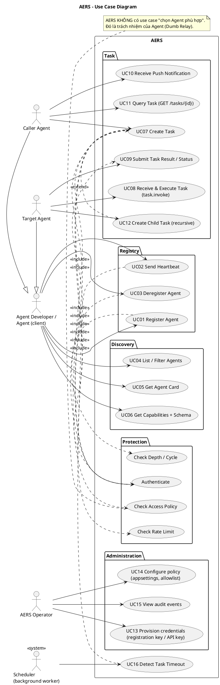

---

## D2. Component Diagram

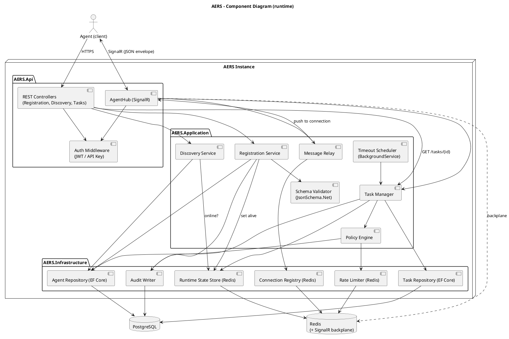

---

## D3. Layer / Package Diagram (Clean Architecture)

Quy tắc: mũi tên = "phụ thuộc vào". `Core` không phụ thuộc bất kỳ layer nào.

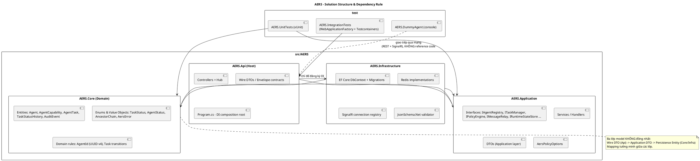

> Gợi ý đặt tên project: `AERS.Core`, `AERS.Application`, `AERS.Infrastructure`, `AERS.Api`,
> `AERS.DummyAgent`. Nếu skeleton hiện tại đặt tên khác, giữ nguyên tên trong repo và chỉ map lại.

---

## D4. Domain Class Diagram (AERS.Core)

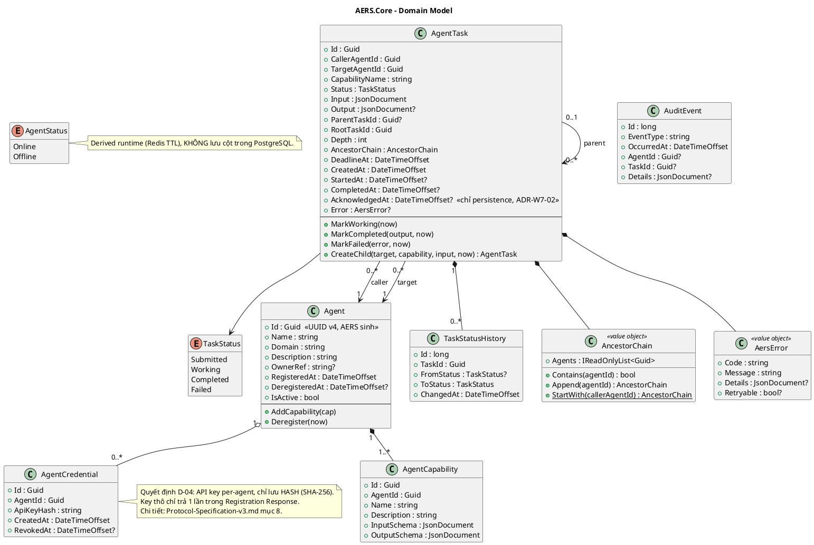

---

## D5. Application Class Diagram ⭐ (interface, service, DTO)

Diagram này là contract của tầng Application cho Tuần 4 (đóng băng tại task T4-01). Interface thuộc Tuần 6–8 chỉ thể hiện ranh giới và chưa có đặc tả chi tiết.

```plantuml
@startuml AERS_Application
title AERS.Application - Interfaces, Services, DTOs
hide empty members

package "Registry (Tuần 4)" {
  interface IAgentRegistry {
    + RegisterAsync(RegisterAgentCommand) : RegisterAgentResult
    + HeartbeatAsync(agentId, AuthenticatedAgentContext) : void
    + DeregisterAsync(agentId, AuthenticatedAgentContext) : void
    + GetAsync(agentId, AuthenticatedAgentContext) : AgentDetailDto
  }
  note right of IAgentRegistry
    Tuần 5 bổ sung: ListAsync(AgentQuery),
    GetCapabilitiesAsync(agentId).
  end note

  class AgentRegistryService
  IAgentRegistry <|.. AgentRegistryService

  interface IAgentRepository {
    + AddAsync(Agent, AgentCredential) : void
    + FindAsync(Guid) : Agent?
    + SaveChangesAsync() : void
  }
  note bottom of IAgentRepository
    SaveChangesAsync commit trong một transaction:
    Agent + AgentCapability[] + AgentCredential + AuditEvent.
  end note

  interface ICredentialRepository {
    + FindActiveByHashAsync(apiKeyHash) : AgentCredential?
    + RevokeAllAsync(agentId, now) : void
  }

  interface IApiKeyService {
    + Generate() : IssuedApiKey
    + Hash(rawKey) : string
  }

  interface IRegistrationKeyValidator {
    + IsValid(presentedKey) : bool
  }

  interface IAgentPresenceStore {
    + MarkAliveAsync(agentId, now, ttl) : void
    + GetAsync(agentId) : AgentPresence
    + RemoveAsync(agentId) : void
  }

  interface IAgentCardValidator {
    + ValidateAndParseRegistration(JsonElement) : AgentCardSubmissionDto
    + ValidateHeartbeatBody(JsonElement?) : void
    + ValidateDeregistrationBody(JsonElement?) : void
  }
  note bottom of IAgentCardValidator
    Validate trên wire JSON (do Api gọi) để phát hiện
    trường lạ như agentId. Chi tiết: Protocol Spec mục 1.2.1.
  end note

  interface IAgentIdGenerator {
    + NewId() : Guid
  }

  interface IAuditWriter {
    + Add(eventType, agentId?, taskId?, details?) : void
  }

  AgentRegistryService --> IAgentRepository
  AgentRegistryService --> ICredentialRepository
  AgentRegistryService --> IApiKeyService
  AgentRegistryService --> IAgentPresenceStore
  AgentRegistryService --> IAgentIdGenerator
  AgentRegistryService --> IAuditWriter
}

package "Task / Policy / Relay (Tuần 6-8)" {
  interface ITaskManager {
    + CreateTaskAsync(callerId, CreateTaskRequestDto) : AgentTask
    + UpdateStatusAsync(taskId, status, result?) : void
    + GetTaskAsync(taskId, requesterId) : TaskQueryResultDto
  }
  interface IPolicyEngine {
    + Authorize(PolicyContext) : PolicyResult
    + CheckRateLimit(callerId) : RateLimitDecision
    + CheckRecursionDepth(rootTaskId, depth) : bool
    + CheckCycle(CycleCheckContext) : bool
  }
  interface IMessageRelay {
    + SendInvocation(targetAgentId, TaskInvocationDto) : void
    + PushStatusEvent(callerAgentId, TaskStatusEventDto) : void
  }
  interface IRuntimeStateStore {
    + SetAsync(TaskRuntimeState, ttl) : void
    + GetAsync(taskId) : TaskRuntimeState?
  }
  interface IConnectionRegistry {
    + Bind(agentId, connectionId, instanceId) : void
    + Unbind(connectionId) : void
    + Resolve(agentId) : ConnectionInfo?
  }
  interface IRateLimiter {
    + TryAcquire(callerId) : RateLimitDecision
  }
}

package "DTOs (Application)" {
  class RegisterAgentCommand {
    + Card : AgentCardSubmissionDto
    + AuthenticatedPrincipal : AuthenticatedAgentContext
  }
  class RegisterAgentResult {
    + AgentId : Guid
    + ApiKey : string  <<hiện đúng 1 lần>>
  }
  class AgentCardSubmissionDto {
    + Name : string
    + Domain : string  <<đã chuẩn hoá>>
    + Description : string
    + OwnerRef : string?
    + Capabilities : List<CapabilityDto>
  }
  class CapabilityDto {
    + Name : string
    + Description : string
    + InputSchema : JsonElement
    + OutputSchema : JsonElement
  }
  class AgentDetailDto {
    + AgentId : Guid
    + Card : AgentCardSubmissionDto
    + Status : AgentStatus
    + LastHeartbeatAt : DateTimeOffset?
  }
  class AgentPresence {
    + IsOnline : bool
    + LastHeartbeatAt : DateTimeOffset?
  }
  class IssuedApiKey {
    + RawKey : string
    + Hash : string
  }
  class AuthenticatedAgentContext {
    + AgentId : Guid?  <<null với registration key>>
    + Domain : string?
    + Scheme : JWT | API_KEY
  }
  class AersPolicyOptions {
    + MaxRecursionDepth = 5
    + DefaultTaskTimeoutSeconds = 300
    + RateLimit : {WindowSeconds=60, MaxTasksPerWindow=100}
    + Heartbeat : {IntervalSeconds=15, OfflineThresholdSeconds=45}
    + CycleDetection.Granularity = AgentOnly
    + DomainPolicy : {Mode=DenyByDefault, CrossDomainRules}
  }
  class AuthOptions {
    + RegistrationKeys : List<string>
  }
  class RegistrationLimitsOptions {
    + MaxNameLength = 200
    + MaxCapabilities = 50
    + MaxSchemaBytes = 65536
    + MaxBodyBytes = 1048576
  }
}

class "AersException" as Ex {
  + Error : AersError
  + HttpStatus : int
}
note right of Ex
  Application ném AersException(code); Api middleware ánh xạ sang
  HTTP status và body AersError (Protocol Spec mục 12.3).
end note
@enduml
```

### Ánh xạ Wire → Application → Persistence (Tuần 4)

| Wire (JSON schema) | Application | Persistence |
|---|---|---|
| `AgentRegistrationRequest{agentCard: AgentCardSubmission}` | `AgentCardSubmissionDto` → `RegisterAgentCommand` | `Agent` + `AgentCapability[]` + `AgentCredential` |
| `AgentRegistrationResponse{agentId, apiKey}` | `RegisterAgentResult` | `agent_credentials.api_key_hash` (chỉ lưu giá trị băm) |
| `AgentDetailResponse{agentCard, runtimeStatus}` | `AgentDetailDto` | `Agent` + `AgentCapability[]` (+ Redis presence) |
| `AgentRuntimeStatus` | `AgentPresence` → `AgentDetailDto.Status/LastHeartbeatAt` | Redis `aers:agent:{id}:alive`, `aers:agent:{id}:lastbeat` |
| `HeartbeatRequest` | không có DTO (chỉ `agentId` từ credential) | Redis |

---

## D6. ERD — PostgreSQL ⭐

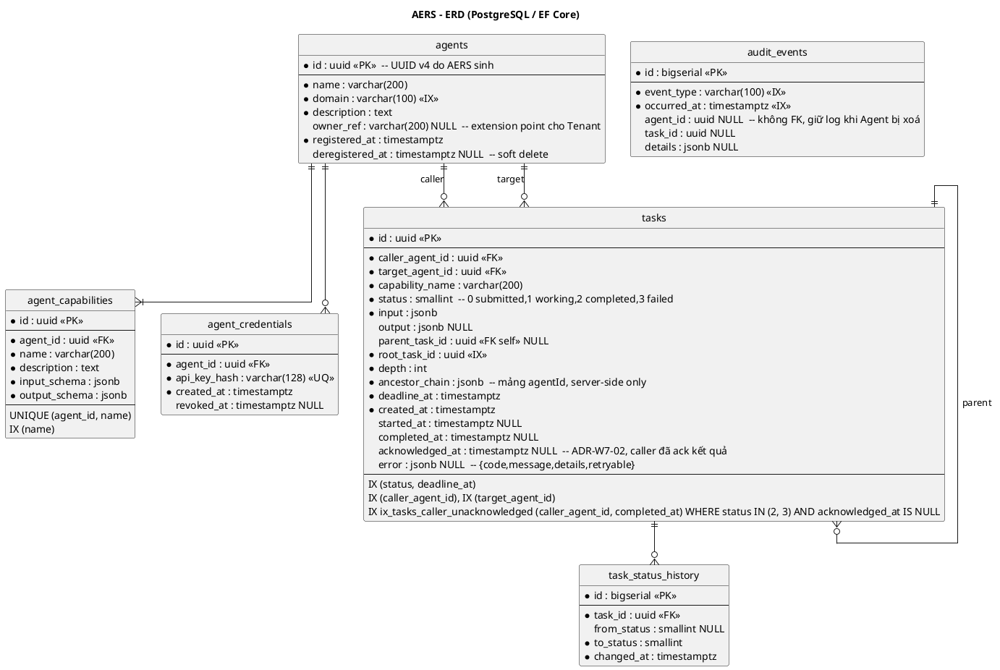

Ghi chú implement EF Core:
- `status` lưu bằng `HasConversion<short>()`; `AncestorChain`/`Error` map bằng `OwnsOne(...).ToJson()` hoặc `HasConversion` sang jsonb (Npgsql).
- `audit_events.agent_id` / `task_id` **không** đặt FK có chủ đích: audit phải sống lâu hơn Agent/Task.
- Không có bảng `domains` / `tenants`: `domain` là cột string có index (đúng quyết định MVP). `owner_ref` nullable giữ chỗ cho Tenant.
- Online/offline **không** có cột: suy ra từ Redis (D7).

---

## D7. Redis Data Model ⭐

```plantuml
@startuml AERS_Redis
title AERS - Redis Keys
hide empty members

class "aers:agent:{agentId}:alive" <<String>> {
  value = "1"
  TTL = 45s (Heartbeat.OfflineThresholdSeconds)
  ghi: SET ... EX 45 (mỗi heartbeat, mỗi 15s)
  đọc: EXISTS -> online/offline
}

class "aers:agent:{agentId}:lastbeat" <<String>> {
  value = ISO-8601 timestamp
  TTL = không (hoặc dài)
  mục đích: trả lastHeartbeatAt cho AgentRuntimeStatus
}
note right
  ĐỀ XUẤT: spec có field lastHeartbeatAt
  nhưng chưa nói lưu ở đâu.
end note

class "aers:task:{taskId}" <<Hash>> {
  taskId, status, updatedAt,
  connectionId, instanceId, deadlineAt
  TTL = deadlineAt - now + 60s (tạo)
        -> 60s khi completed/failed
}

class "aers:ratelimit:{callerAgentId}:{windowStart}" <<String counter>> {
  INCR + EXPIRE 60s
  limit = 100 task.create / window
}

class "aers:conn:{agentId}" <<Hash>> {
  connectionId, instanceId
  mục đích: Relay biết Agent đang nối instance nào
}
note right
  ĐỀ XUẤT (spec chưa chốt "connection mapping").
  SignalR backplane đã lo route theo connectionId,
  nhưng cần map agentId -> connectionId.
end note

note right of "aers:task:{taskId}"
  R3 (ADR-W7-01): chỉ ghi. Ghi sau commit thắng compare-and-set,
  HSET + PEXPIRE trong một Lua script. TTL = deadline - now + 60s
  (chưa terminal) hoặc 60s (terminal).
end note

class "aers:disconnected" <<Sorted set>> {
  member = agentId, score = unix ms lúc ngắt kết nối
  không TTL; worker xoá khi Agent nối lại hoặc hết Task working
  ADR-W7-03: ân hạn TargetDisconnectGraceSeconds = 30
}

class "aers:agent:revoked" <<Pub/Sub channel>> {
  message = agentId (khi deregister)
  mọi instance subscribe, instance giữ kết nối thì abort
  ADR-W8-03; không lưu tin
}
@enduml
```

---

## D8. Sequence — Register Agent ⭐

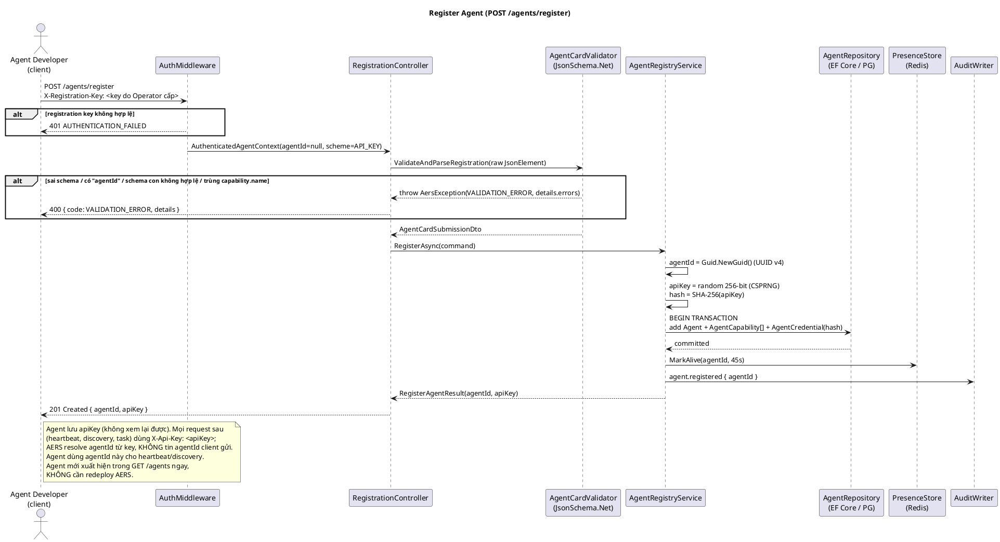

---

## D9. Sequence — Heartbeat, Online Status, Deregister ⭐

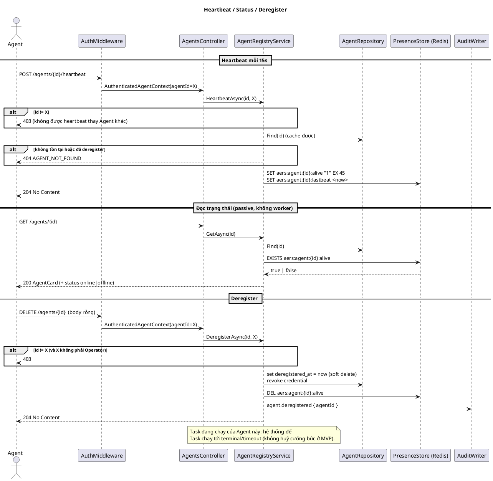

---

## D10. Sequence — Discovery

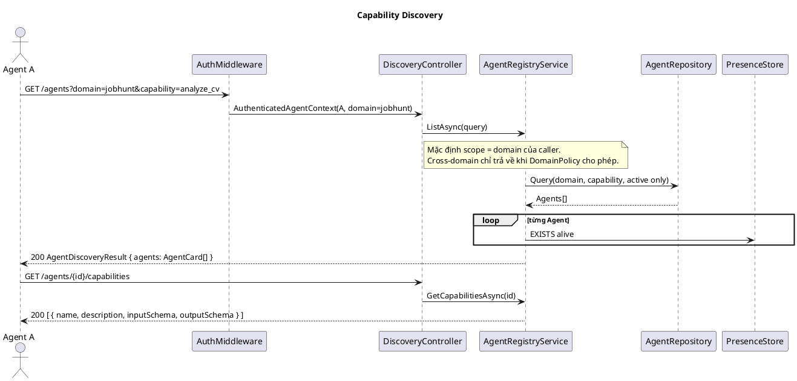

---

## D11. Sequence — Sync Task A → B (đủ pipeline, SignalR)

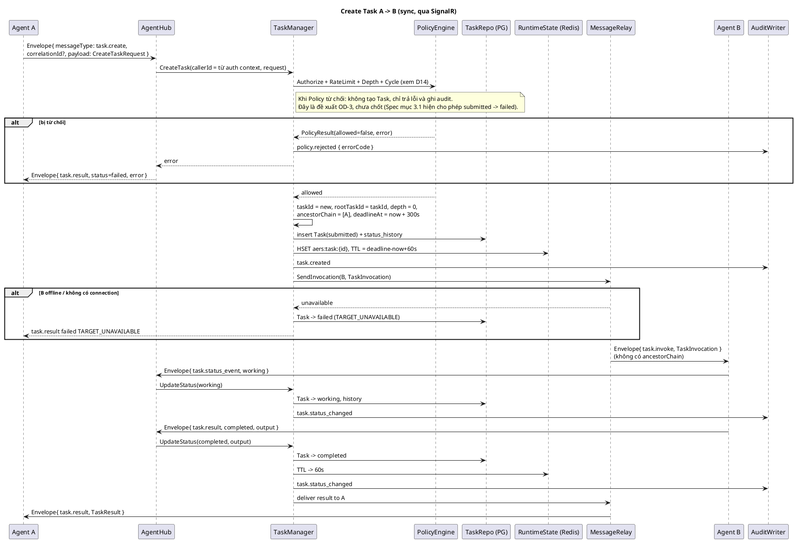

---

## D12. Sequence — Async + đệ quy + cycle

> Công thức đã chốt: `ancestorChain_new = ancestorChain_parent + [targetAgentId của parent]`.
> Công thức xác định chuỗi của Task con; chuỗi của root Task được khởi tạo là `[callerAgentId]`. Nếu root Task bắt đầu với chuỗi rỗng, Agent gọi gốc không bao giờ nằm trong chuỗi và vòng A→B→C→A không bị phát hiện. Xem `Protocol-Specification-v3.md` mục 4 và quyết định D-07.

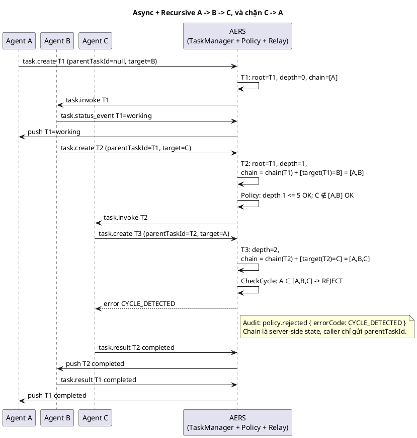

---

## D13. Sequence — Timeout worker + Reconnect

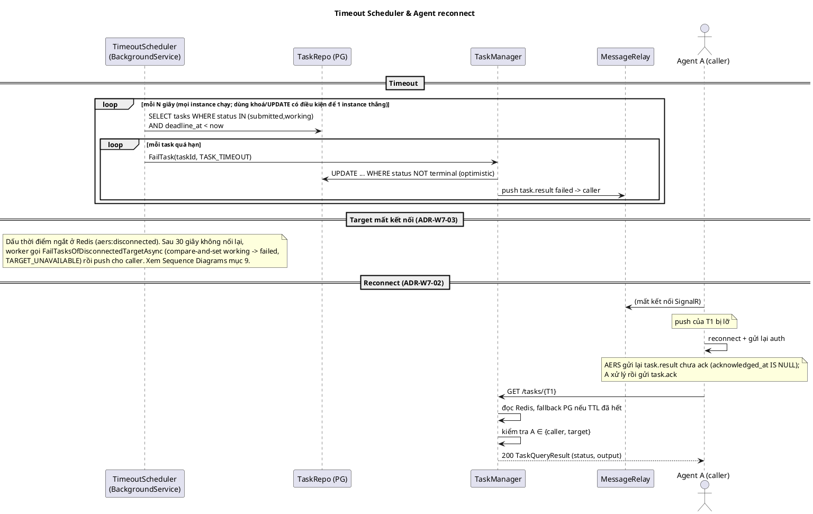

---

## D14. Activity — Policy Pipeline

Thứ tự theo `Protocol-Specification-v3.md` mục 9.4 (R3, ADR-W8-01). Mọi nhánh từ chối từ bước rate limit trở đi ghi audit `policy.rejected { errorCode }` và trả `AersError` cho caller; không tạo Task.

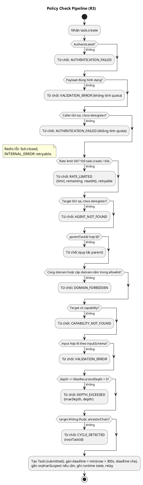

---

## D15. State Diagrams

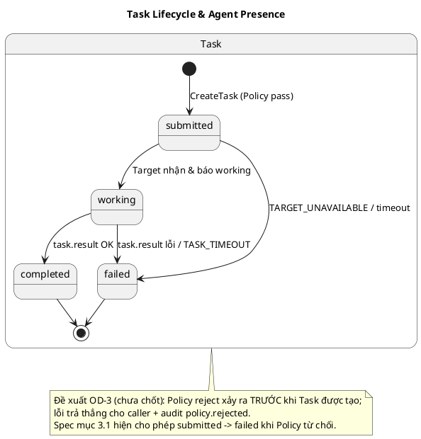

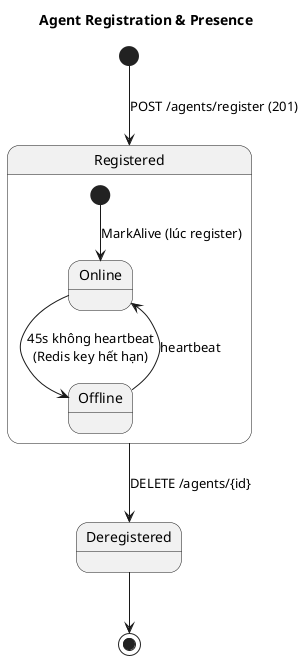

---

## D16. Deployment Diagram

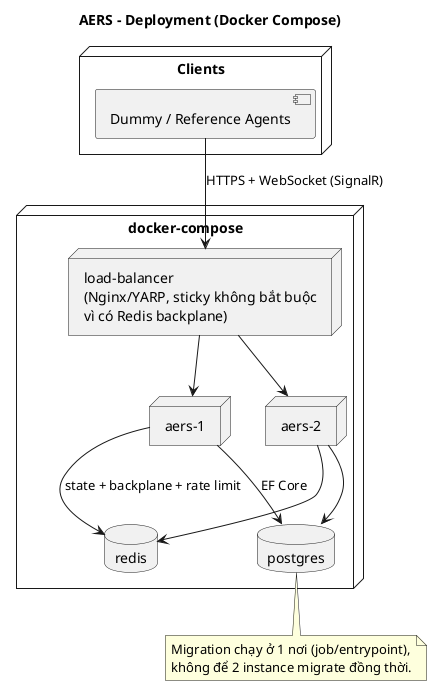

---

## Tham chiếu quyết định thiết kế

Các quyết định ảnh hưởng đến diagram trong tài liệu này được quản lý tại `05-decision-log-v3.md`.

| Mã | Nội dung | Diagram liên quan | Trạng thái |
|---|---|---|---|
| D-04 | Credential: registration key + Agent API key (hash SHA-256) | D4, D5, D6, D8, D9 | Approved |
| D-05 | Deregistration xoá mềm | D4, D6, D9, D15 | Approved |
| D-07 | Công thức `ancestorChain`; root = `[callerAgentId]` | D4, D12 | Approved (trường hợp cơ sở: Adopted R2) |
| OD-3 | Policy từ chối có tạo Task `failed` hay không | D11, D15 | Open |
| OD-5 | Bước kiểm tra `input` theo `inputSchema` trong Policy | D14 | Adopted R2 |
| ADR-W7-01 … W9-02 | Chín quyết định Tuần 7 (runtime state chỉ ghi, `task.ack`, ân hạn mất kết nối, rate limit sớm, thu hồi kết nối, ...) | D4, D6, D7, D9, D13, D14 | Accepted |
| OD-6 | Lưu `deadline_at`, `ancestor_chain` ở PostgreSQL | D4, D6, D13 | Adopted R2 |

---

## Lịch sử sửa đổi

| Revision | Nội dung |
|---|---|
| R1 | Bản khởi tạo (16 diagram). |
| R2 | Đồng bộ trước Tuần 4: D5 cập nhật theo contract đã đóng băng (tách `IApiKeyService`, `IRegistrationKeyValidator`, `ICredentialRepository`; validator nhận wire JSON; `RegisterAgentResult` có `apiKey`); D8 chuyển bước validate sang trước service; D12 làm rõ trường hợp cơ sở của `ancestorChain`; D14 viết lại theo cú pháp `detach` và thêm bước validate `input`; thay phần quyết định cuối tài liệu bằng tham chiếu Decision Log. |
| R3 | Đồng bộ Tuần 7: D4 và D6 thêm `acknowledged_at` và index một phần; D7 thêm `aers:disconnected` và kênh `aers:agent:revoked`; D13 ghi chú ân hạn và gửi lại; D14 viết lại theo thứ tự Policy mới. |
