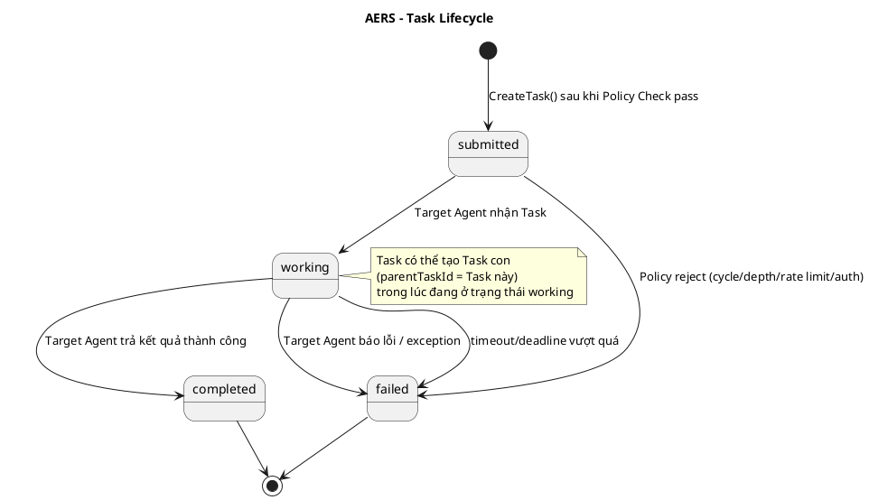
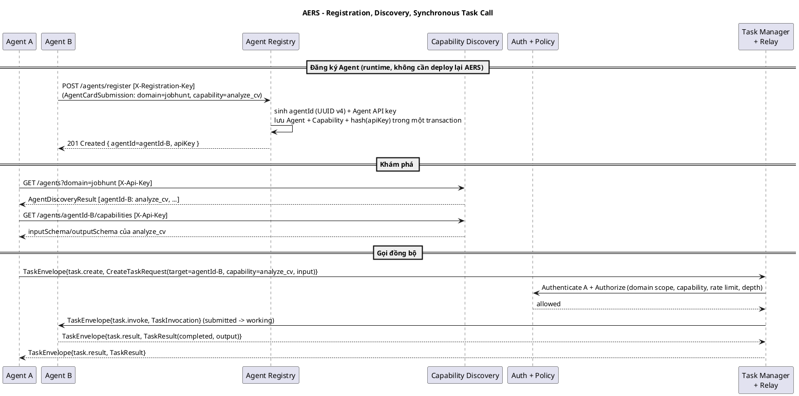
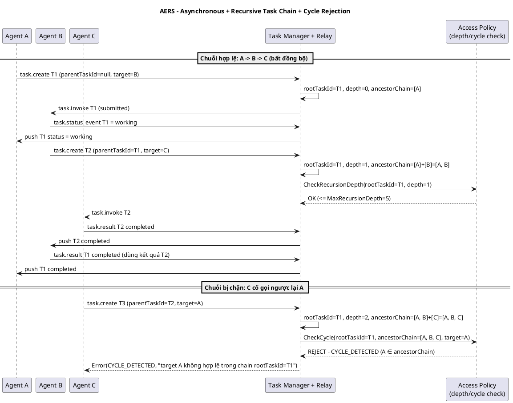
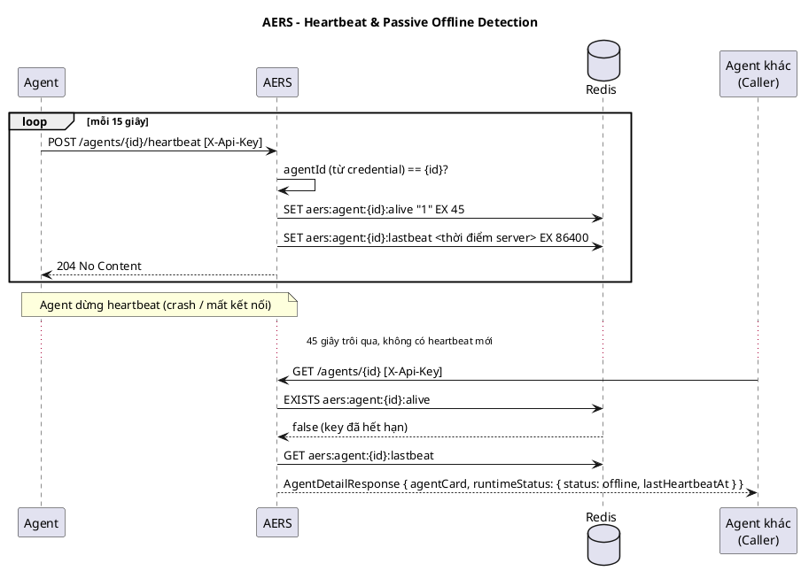
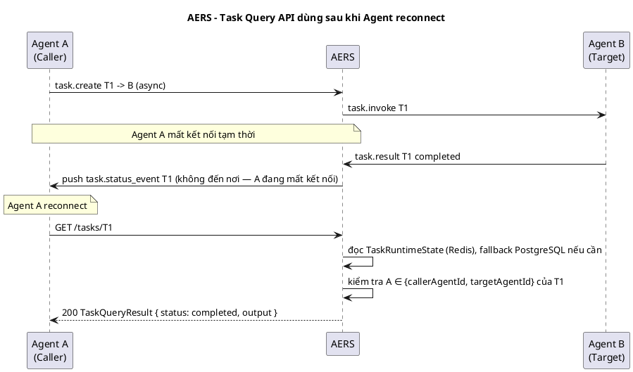
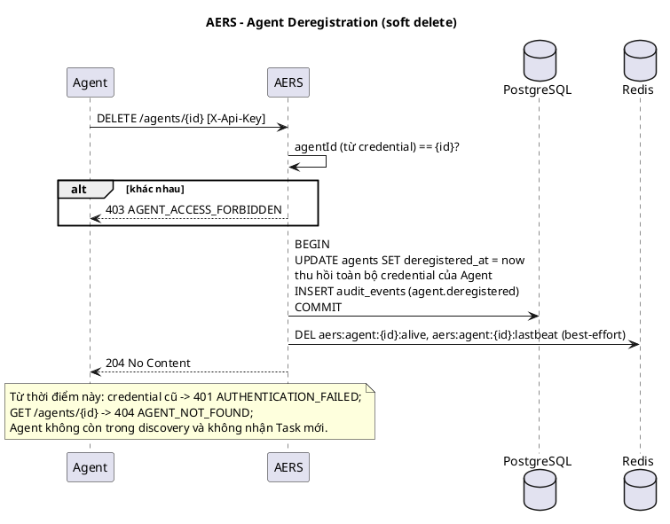
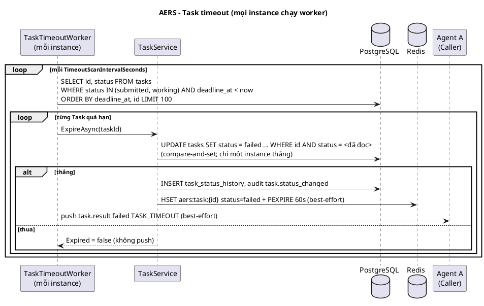
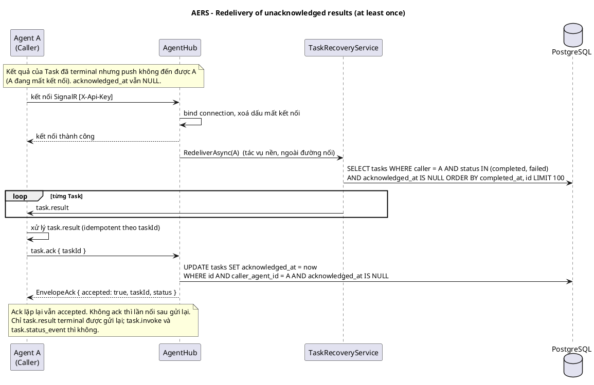
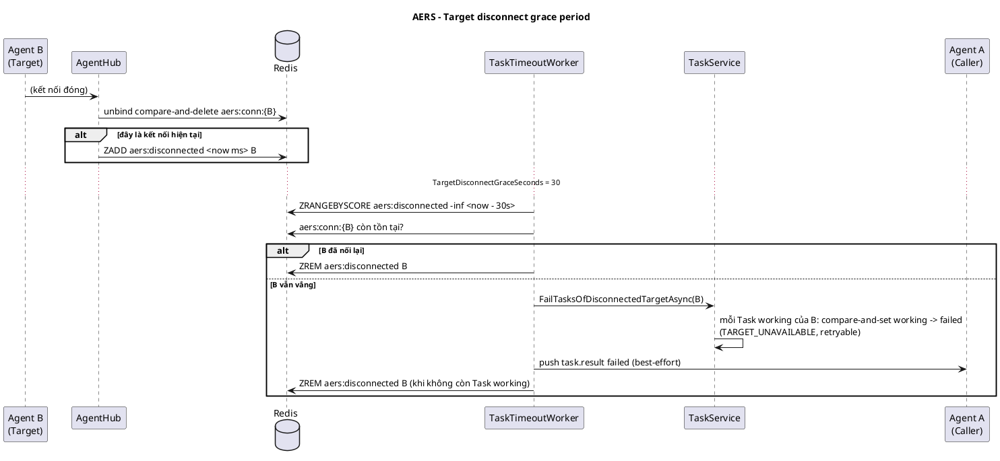

# AERS — Protocol Sequence Diagrams v1.0

**Đề tài:** Phát triển hệ thống backend cho Agent-to-Agent Runtime (AERS)
**Trạng thái:** Final — Deliverable chính thức Tuần 2 (Thiết kế Protocol)
**Đi kèm:** `Protocol-Specification-v3.md` (protocol v1.0, Revision R2)
**Revision:** R3 — đồng bộ Tuần 7 (xem cuối tài liệu)

---

## 1. Task Lifecycle (State Diagram)

---

## 2. Đăng ký Agent, Discovery, và gọi đồng bộ (A → B)

---

## 3. Gọi bất đồng bộ + đệ quy, và cycle rejection

---

## 4. Heartbeat & Agent Offline Detection

---

## 5. Task Query sau khi Agent reconnect

---

## 6. Deregistration (xoá mềm)

---

## 7. Task timeout (worker)

---

## 8. Push, task.ack và gửi lại kết quả

---

## 9. Target mất kết nối và thời gian ân hạn

---

## Lịch sử sửa đổi

| Revision | Nội dung |
|---|---|
| R1 | Bản Final của Tuần 2. |
| R2 | (1) Mục 2: đăng ký dùng `X-Registration-Key`, response gồm `agentId` và `apiKey`; thay mã định danh minh hoạ `cv-agent-001` bằng `agentId-B` (UUID v4 do AERS cấp); bổ sung `X-Api-Key` cho các request sau. (2) Mục 3: `ancestorChain` của root Task là `[A]`; T2 `[A, B]`; T3 `[A, B, C]`. (3) Mục 4: heartbeat bổ sung kiểm tra danh tính, key `lastbeat`, response 204. (4) Mục 6: bổ sung sequence Deregistration. |
| R3 | Đồng bộ Tuần 7: thêm mục 7 (timeout worker), 8 (task.ack và gửi lại), 9 (ân hạn khi target mất kết nối). |
